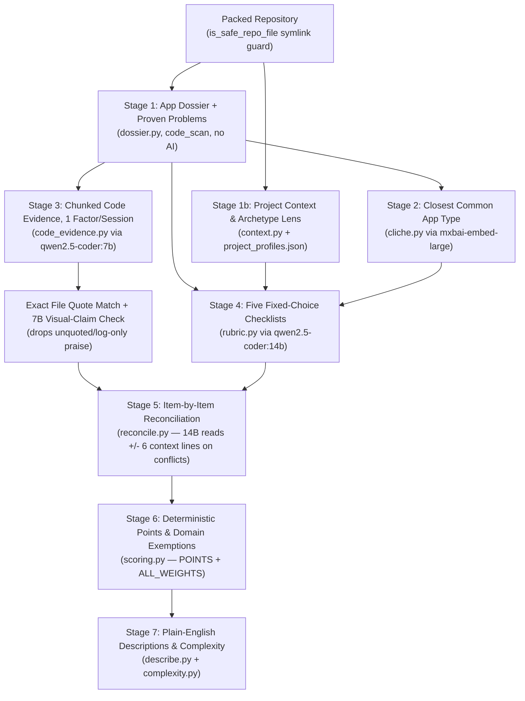

<p align="center">
  <a href="https://ko-fi.com/todd0042">
    
  </a>
</p>

---

# 🧠 LetsVibe Engine — The Versioned Evaluation Engine for Vibe-Coded Software

[](https://github.com/Todd0042/letsvibe-engine)
[](LICENSE)
[-blueviolet.svg)](https://letsvibe.todd0042.dev/how-it-works)
[]()
[-black.svg)](https://ollama.com)
[]()
[](https://ko-fi.com/todd0042)

> 🤖 *Like LetsVibe itself, `letsvibe-engine` was vibe-coded: directed by [Todd0042](https://github.com/Todd0042), written by Antigravity (Gemini) and Claude Code. [Provenance & Licensing](#-6-provenance-ethics--licensing).*

> **The standalone, versioned AI evaluation engine behind [LetsVibe](https://letsvibe.todd0042.dev) ([Todd0042/letsvibe](https://github.com/Todd0042/letsvibe)). Houses every grading rubric from `v1.0` through `v9.4`, domain archetype lenses, App Dossier builders, deterministic point tables, and dual-review reconciliation logic.**

🌐 **Live site:** [letsvibe.todd0042.dev](https://letsvibe.todd0042.dev) &nbsp;·&nbsp; 🖥️ **Web platform repo:** [Todd0042/letsvibe](https://github.com/Todd0042/letsvibe)

---

## 📖 Table of Contents

* **Part 1 — Overview**
  * [🎨 What Is `letsvibe-engine`?](#-what-is-letsvibe-engine)
  * [🧭 The 5 Factors & Fixed Weights](#-the-5-factors--fixed-weights)
  * [🎭 7 Domain Archetype Lenses & Exemptions](#-7-domain-archetype-lenses--exemptions)
  * [🕰️ All 13 Rubric Generations (v1.0 → v9.4)](#️-all-13-rubric-generations-v10--v94)
  * [🛠️ Installation & Usage](#️-installation--usage)
* **Part 2 — Technical Reference**
  * [1. Architecture & the v9.4 Hybrid Grading Pipeline](#1-architecture--the-v94-hybrid-grading-pipeline)
  * [2. Stage-by-Stage Execution](#2-stage-by-stage-execution)
  * [3. Submitter Context & Grounding Verification](#3-submitter-context--grounding-verification)
  * [4. Unified Router & Engine Registry (`api.py`, `registry.json`)](#4-unified-router--engine-registry-apy-registryjson)
  * [5. Repository Structure](#5-repository-structure)
  * [6. Provenance, Ethics & Licensing](#6-provenance-ethics--licensing)

---

# Part 1 — Overview

## 🎨 What Is `letsvibe-engine`?

Most automated code reviewers grade weekend apps as if they were enterprise banking backends. **`letsvibe-engine`** takes the opposite approach: it judges vibe-coded software on **what a real user actually experiences**, comparing vibe-coded projects strictly against other vibe-coded projects.

Three rules govern every grade in `v9.4`:

1. **No AI picks a number**: Models answer fixed-choice checklists (`CLEARLY`, `SOME_LOOSE_ENDS`, `TIER_2_ITERATIVE_NICHE`, booleans) — never arbitrary `1–10` or `0–100` guesses. Deterministic Python tables convert verified answers into exact point totals.
2. **Every claim requires a verified quote**: Checklist answers must quote lines from the App Dossier or real repository source files. If a quote is not physically present in the file or dossier, Python discards the answer before scoring.
3. **Eat your own cooking**: We even submitted `Todd0042/letsvibe-engine` to LetsVibe under Rubric `v9.4` — and it scored **`33.6 (F)`** because it is an internal library with no standalone end-user UI or onboarding flow. No house thumb on the scale.

---

## 🧭 The 5 Factors & Fixed Weights

All weights live in `scoring.py` (`ALL_WEIGHTS`) and stay identical across every project, while category/domain archetypes shape what counts as "good enough" inside each checklist:

| Factor | Core Question | Weight |
| :--- | :--- | :---: |
| **Real-World Value** | More than a one-prompt toy? Adapted for a genuine niche, solving something free tools overcomplicate, or built around an engaging loop? | **25%** |
| **Creativity** | On-screen voice/personality, unconventional UI subversion, cohesive world/theme, and features that amplify each other. | **22%** |
| **User Journey** | From install to close: immediate launch vs. heavy setup, landing straight on the core task, automatic saving, and zero ads/paywalls/forced sign-in. | **20%** |
| **Functionality** | Does the main workflow run end-to-end, do features connect, and does it show errors and success states? Penalizes proven dead/broken code per 1,000 LOC. | **18%** |
| **UI / UX** | Visual clarity, consistency, loading/working feedback, accessibility labels, and ergonomics matched to the target device/domain. | **15%** |

* **Code complexity** (`complexity.py`) is summarized in plain English for every public report and **never counts toward the score**.
* **Code health** findings from static checks stay private to the repository owner as maintainer notes and **never count toward the score**.
* **Safety is not graded**: LetsVibe is not a security scanner (`MALICIOUS_HOLD_ENABLED = False`).

---

## 🎭 7 Domain Archetype Lenses & Exemptions

Defined in [`letsvibe_engine/profiles/project_profiles.json`](letsvibe_engine/profiles/project_profiles.json), Rubric `v9.4` matches each project to its real domain so a terminal CLI isn't dinged for lacking browser ARIA labels and an embedded car dash isn't penalized for lacking desktop menus:

| Profile Key | Domain | Focus & Key Exemptions |
| :--- | :--- | :--- |
| `developer_tool_or_mcp` | **Developer Tool / MCP Server** | Rewards CLI clarity, schema precision, and fast `pip`/`npm` onboarding. Exempts `screen_reader_labels`, `avoidance_of_technical_jargon`, `form_contrast`, and `consumer_onboarding_wizards`. |
| `interactive_game_or_simulation` | **Game / Interactive Simulation** | Focuses on frame feel, game-loop balance, HUD legibility, and instant playability. Exempts `standard_navigation_menus`, `account_sign_in_forms`, `crud_data_tables`, and `avoidance_of_gaming_terms`. |
| `media_or_social_lounge` | **Media / Audio / Local Social Lounge** | Values dual-screen stage contrast, real-time sync, and QR/URL zero-install guest onboarding. Exempts `avoidance_of_audio_terminology`. |
| `hardware_iot_or_mobile` | **Hardware / IoT / Mobile Companion** | Focuses on glanceable gauges, touch targets, fault tolerance, and headless/power-on startup. Exempts `desktop_multi_window_controls` and `dense_text_data_tables`. |
| `web_productivity_app` | **Web Productivity / Dashboard App** | Checks end-to-end CRUD, clear data visualization, export/import, and local-first state retention. |
| `automation_script_or_pipeline` | **Automation Script / Data Pipeline** | Rewards idempotent runs, backoff, terminal progress/logging, and one-command `.env` setup. Exempts `graphical_ui_elements`, `css_styling`, and `screen_reader_labels`. |
| `unknown_or_general` | **General Software / Unknown Archetype** | Evaluates core usability for whatever interface exists (web, desktop, terminal). Exempts `screen_reader_labels` and `advanced_animation_polish`. |

---

## 🕰️ All 13 Rubric Generations (`v1.0` → `v9.4`)

Registered in [`letsvibe_engine/registry.json`](letsvibe_engine/registry.json) so historical grades stay reproducible and admins can benchmark older rubrics side-by-side:

| Version | Registry ID | Module | Status | Key Milestone |
| :--- | :--- | :--- | :---: | :--- |
| **v9.4** | `blend` *(default)* | `v9_4_experimental` | `production` | Submitter context weighting, claim grounding, and 7 archetype lenses |
| **v9.3** | `v9.3` | `v9_3_archetypes` | `testing` | Domain archetype lenses, Hackathon Judge rubric framing, and exemptions |
| **v9.2** | `v9.2` | `v9_2_context` | `testing` | Upfront `context.py` project brief (README/GitHub/commits) & `seed=0` repeatability |
| **v9.1** | `v9.1` | `v9_1_negatives` | `testing` | Negative evidence checks, quote relevance verification, and two-file whole-app rules |
| **v9** | `v9.0` | `v9_0_hybrid` | `testing` | Hybrid two-review architecture (14B App Dossier + per-factor 7B code evidence) |
| **v8** | `v8.0` | `v8_0_dossier` | `testing` | Pure App Dossier experience grading (no raw code scoring, fixed points) |
| **v7** | `v7.0` | `v7_0_triage` | `testing` | 7-factor consensus + pre-review file triage + 23 binary checks |
| **v6** | `v6.0` | `v6_0_vibe` | `testing` | Native vibe-coded baseline, User Journey introduction, 33 binary checks |
| **v5** | `v5.0` | `v5_0_holds` | `testing` | Legacy 7 factors + owner pre-publish explanation holds |
| **v4** | `v4.0` | `v4_0_device` | `testing` | Hardware/platform classification, weight clamping, relevant-chunk filtering |
| **v3** | `v3.0` | `v3_0_reliability` | `testing` | Fixed silent prompt truncation, schema retries, vendored-code exclusion |
| **v2** | `v2.0` | `v2_0_checklist` | `testing` | 50/50 blend of 33 binary yes/no checks with 7B/14B scores; `62 = C` alignment |
| **v1** | `v1.0` | `v1_0_beta` | `testing` | Initial Beta 7B micro-chunk + 14B macro dual-model local pipeline |

---

## 🛠️ Installation & Usage

`letsvibe-engine` is designed to run alongside the main [LetsVibe](https://github.com/Todd0042/letsvibe) package (`letsvibe.analyzers`, `letsvibe.core`, `letsvibe.evaluator.ollama`, `letsvibe.evaluator.pipeline`, `letsvibe.storage`) with [Ollama](https://ollama.com) serving `qwen2.5-coder:7b`, `qwen2.5-coder:14b`, and `mxbai-embed-large`:

```bash
git clone https://github.com/Todd0042/letsvibe-engine.git
cd letsvibe-engine
pip install -e .
```

### Python Router API ([`letsvibe_engine/api.py`](letsvibe_engine/api.py))

```python
from letsvibe_engine import get_available_engines, get_engine_info, run_engine

# List engines visible to public users (pass include_testing=True for all 13 versions)
prod_engines = get_available_engines()
info = get_engine_info("blend")  # Resolves default production engine (Rubric v9.4)

# Run evaluation against a packed repo, deterministic metrics, and classification
report = run_engine(
    engine_id="blend",
    client=ollama_client,
    packed_repo=packed_repo,
    repo_source="https://github.com/owner/repo",
    metrics=metrics,
    classification=classification,
    submission_meta={"project_profile": "developer_tool_or_mcp"},
)
```

---
---

# Part 2 — Technical Reference

## 1. Architecture & the `v9.4` Hybrid Grading Pipeline

Rubric `v9.4` runs all `7B` work before loading the `14B` model so an 8 GB GPU never swaps models back and forth mid-grade, enforcing an explicit `LETSVIBE_TIME_LIMIT_MIN` deadline (default `180` minutes) before every Ollama call (`_CallLog`). If any stage exceeds the limit or fails schema validation, `TimeLimitExceeded` / `CpuSpilloverError` halts execution and publishes nothing.



---

## 2. Stage-by-Stage Execution

Inside [`letsvibe_engine/versions/v9_4_experimental/`](letsvibe_engine/versions/v9_4_experimental/):

* **`dossier.py` (App Dossier, ~3,000 tokens / `CAP = 12000` chars):** Pure Python, never executes repository code, and skips any symlink outside the repo root via `is_safe_repo_file`. Extracts README pitch, window titles, libraries, data models, API endpoints, screens, multi-device network/QR views, setup input counts and technical jargon share, save mechanisms, UI feedback counts, code-level hostile patterns (`AdMob`, `Stripe`, `RevenueCat`, `Clerk`/`Auth0`), and user-visible on-screen strings.
* **`cliche.py` (Common App Comparison):** Uses `mxbai-embed-large` to match the project against [`archetypes.json`](letsvibe_engine/profiles/archetypes.json) and hands the top similarity match to checklists strictly as neutral context.
* **`code_evidence.py` (`qwen2.5-coder:7b`):** Reads filtered repository chunks (`build_batches`) one factor per session (`functionality`, `ui_ux`, `user_journey`, `creativity`) only on relevant files. Every claim requires exact quoted lines present in the real file; UI/feedback praise must cite user-visible UI code rather than server logs, followed by a `7B` verification pass checking that the quote supports the claim.
* **`rubric.py` (`qwen2.5-coder:14b`):** Evaluates the five factor checklists against the App Dossier plus project context and domain archetype exemptions, quoting dossier lines for every answer (`NOT_SHOWN_IN_DOSSIER` keeps middle credit so invisible scans never turn into penalties).
* **`reconcile.py` (`Python + 14B`):** Compares `code_evidence.py` and `rubric.py` answer-by-answer: agreement stands, code fills `NOT_SHOWN_IN_DOSSIER` gaps, and conflicts feed both quotes plus `CONTEXT_LINES = 6` surrounding code lines to the `14B` to pick `A`, `B`, or `NEITHER` with a deciding line verified by Python.
* **`scoring.py` (Fixed Points & Exemptions):** Converts reconciled answers via `POINTS` and `ALL_WEIGHTS` (25 / 22 / 20 / 18 / 15), subtracts `proven_problem_rate_penalty` (per 1,000 LOC, max `-20`), applies `-50` for code-proven `hostile_penalty`, and exempts irrelevant shortfalls (`shortfall()`) listed in the archetype's `exemptions` (`avoidance_of_technical_jargon`, `screen_reader_labels`, etc.).
* **`describe.py` & `complexity.py`:** Rewrites checked findings into weakest-first factor summaries and "Areas Needing Attention" (`PROBLEM_ANSWERS` and `MIDDLE_ANSWERS`) while filtering out contradictions; formats unscored cyclomatic complexity summaries; `enginelog.py` records prompt/timing telemetry locally without storing raw code externally.

---

## 3. Submitter Context & Grounding Verification

In `v9.4`, optional submitter intake metadata (`submission_meta`: `project_profile`, `provenance`, `guest_access`, `user_hook`) flows into [`context.py`](letsvibe_engine/versions/v9_4_experimental/context.py) alongside repository facts:

1. **`gather(...)`** inspects tracked files (`kind_from_files`, `FIRM_KINDS`), README headings/features/quick-start sections (`readme_parts`), GitHub repo metadata (`github_meta`), and recent commit/release notes (`commit_notes`), combining them with `submission_meta` to select one of the 7 domain archetypes (`detect_project_profile`).
2. **`understand(...)`** uses one `14B` pass constrained to quoted excerpts from `sources_text(s)` to summarize purpose, audience, kind, and stated features — discarding any unverified claim and never letting file hints be overridden once `FIRM_KINDS` proves the project type from disk.
3. **`render(ctx)`** prepends `## 0. What the project says it is` to the dossier explicitly labeled as *context only, never proof that a feature works*, preserving checklist grounding against real files and dossier counts.

---

## 4. Unified Router & Engine Registry (`api.py`, `registry.json`)

[`letsvibe_engine/api.py`](letsvibe_engine/api.py) exposes the stable contract consumed by [LetsVibe](https://github.com/Todd0042/letsvibe):

* `load_registry()` / `get_available_engines(include_testing=False)`: Reads [`registry.json`](letsvibe_engine/registry.json) to separate `production` engines from `testing` engines (`status`).
* `get_engine_info(engine_id)`: Resolves aliases (`blend`, `fast`, `deep`, `v9.4-test`, `v9.0-test`, `v8.0-test`) to their target module and `rubric_rank`.
* `rubric_version_rank(version)`: Maps version strings (`v9.4` -> `904`, `v9` -> `900`, `v1` -> `100`) for SQLite sorting.
* `run_engine(...)`: Dynamically imports `letsvibe_engine.versions.<module>` and runs `evaluate(...)`, tagging the resulting `VibeReport` with the canonical `rubric_version`.

---

## 5. Repository Structure

```text
letsvibe-engine/
├── LICENSE
├── README.md
├── pyproject.toml                       # Package definition (letsvibe-engine 9.4.0)
└── letsvibe_engine/
    ├── __init__.py                      # Exports router helpers from api.py
    ├── api.py                           # Unified registry & evaluation dispatcher
    ├── registry.json                    # Manifest for all 13 engines (v1.0 -> v9.4)
    ├── data/                            # Packaged reference profiles & curve calibration JSON
    ├── profiles/                        # 7 domain archetype lenses, complexity forms & calibration
    └── versions/
        ├── v9_4_experimental/           # Production default (Submitter Context & Grounding)
        │   ├── __init__.py              # Hybrid pipeline orchestrator & deadline enforcement
        │   ├── context.py               # Project & submitter context builder/grounding
        │   ├── dossier.py               # Static App Dossier builder + symlink guard
        │   ├── cliche.py                # Embedding-based common archetype matcher
        │   ├── code_evidence.py         # 7B chunked per-factor review + quote verification
        │   ├── rubric.py                # 14B dossier checklists + Hackathon Judge framing
        │   ├── reconcile.py             # Dual-review conflict resolution (code +/- 6 lines)
        │   ├── scoring.py               # Fixed points, weights & domain exemptions
        │   ├── describe.py              # Contradiction-filtered summaries & next steps
        │   ├── complexity.py            # Unscored plain-English complexity formatter
        │   └── enginelog.py             # Local timing & trace logger
        ├── v9_3_archetypes/             # Rubric v9.3 (Archetypes & Domain Exemptions)
        ├── v9_2_context/                # Rubric v9.2 (Project Context & seed=0)
        ├── v9_1_negatives/              # Rubric v9.1 (Negative Evidence & 2-File Checks)
        ├── v9_0_hybrid/                 # Rubric v9.0 (Original Hybrid Dossier + 7B)
        ├── v8_0_dossier/                # Rubric v8.0 (Pure App Dossier Experience Grading)
        └── v1_0_beta/ ... v7_0_triage/  # Historical rubrics v1 through v7
```

---

## 6. Provenance, Ethics & Licensing

### 🤖 How `letsvibe-engine` was made
| Contributor | Role |
| :--- | :--- |
| **[Todd0042](https://github.com/Todd0042)** | Creator: grading philosophy ("vibe-coded software graded as vibe-coded software"), factor priorities, archetype exemptions, domain testing, and product direction |
| **Antigravity** (Google, Gemini models) | Dual-model local pipeline architecture, git-aware ingestion & chunking, initial rubric generations, fail-closed JSON constraints, and archetype system |
| **Claude Code** (Anthropic, Claude Opus 5.5) | Experience grading (`dossier.py`, quote checks, fixed points, `reconcile.py`), reference calibration, and hybrid `v8`/`v9` pipeline refinements |

### ⚖️ License
* **License**: [PolyForm Noncommercial License 1.0.0](LICENSE) — free for personal, hobby, educational, research and nonprofit use; commercial use (inside a company, in a paid product or service, or for profit) requires a separate license from [Todd0042](https://github.com/Todd0042).
* Questions & security reports: see [Todd0042/letsvibe](https://github.com/Todd0042/letsvibe) or email **[todd.0042.git@gmail.com](mailto:todd.0042.git@gmail.com)**.

---

<p align="center">
  If LetsVibe and its evaluation engine have been helpful, consider supporting development:<br/><br/>
  <a href="https://ko-fi.com/todd0042" target="_blank">
    
  </a>
</p>

---

<p align="center">
  <a href="https://ko-fi.com/todd0042">
    
  </a>
</p>
